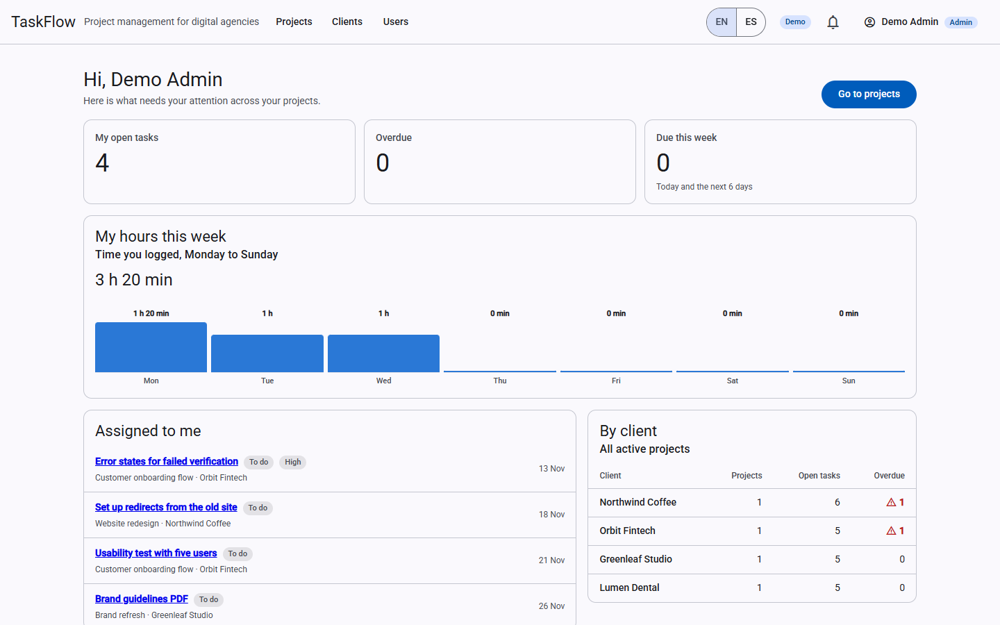
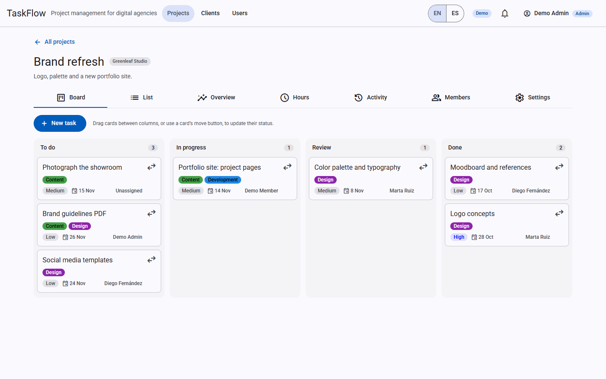
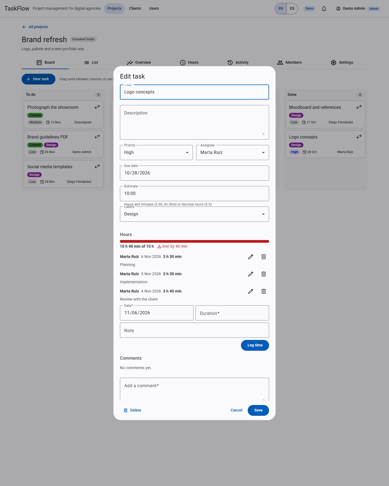
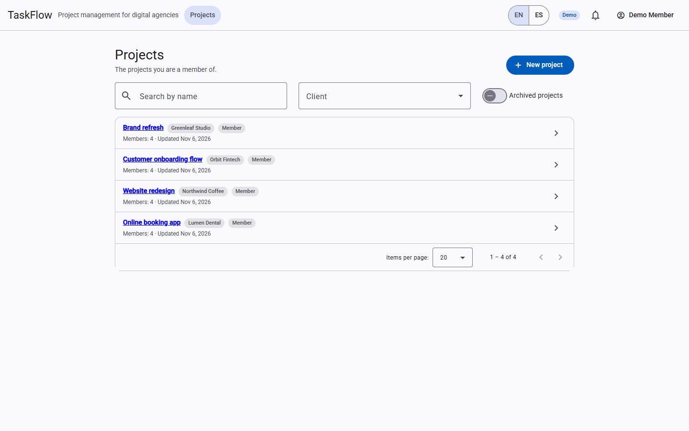
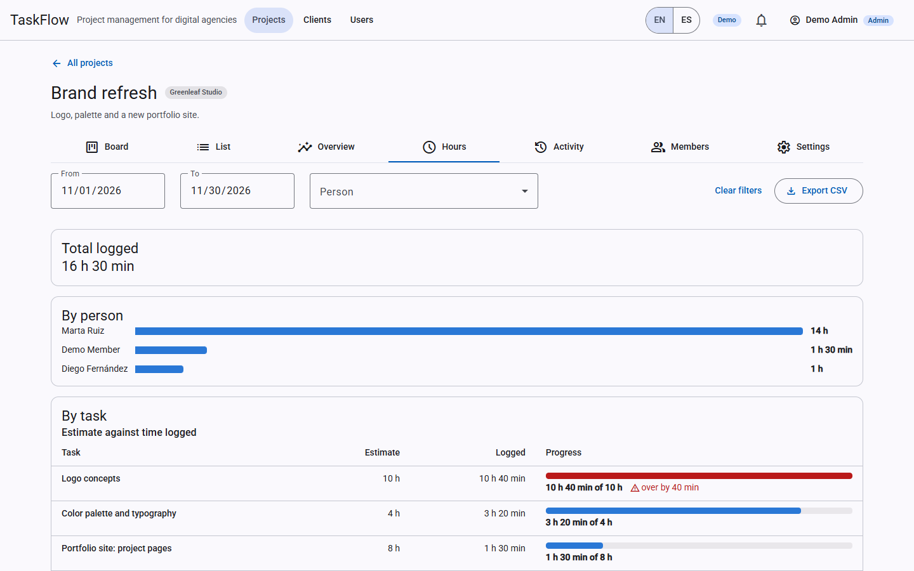
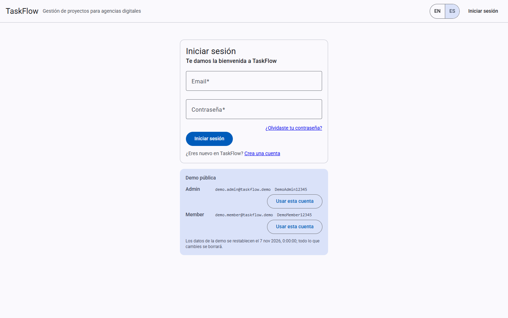

# TaskFlow

[](https://github.com/fernando-acevedo/taskflow/actions/workflows/backend-ci.yml)
[](https://github.com/fernando-acevedo/taskflow/actions/workflows/frontend-ci.yml)

TaskFlow is a project-management app for digital agencies: clients, projects, a Kanban board, task comments with
mentions, time tracking and a workload dashboard, in English and Spanish. It is a full-stack portfolio project:
an ASP.NET Core 10 API in Clean Architecture on SQL Server, an Angular 22 frontend with NgRx and Angular Material,
and a free-tier Azure deployment defined in Bicep.

> **Status:** phases 0 to 5 are done in code and phase 6 (polish) is in progress; the first Azure deploy is pending.
> **Live demo:** `https://<your-static-web-app>.azurestaticapps.net` (coming once deployed; this is a placeholder,
> not a working URL). Demo data resets nightly, and the demo credentials are shown on the login page.

## Screenshots

| | |
| --- | --- |
|  |  |
|  |  |
|  |  |

Regenerate them with `npm run screenshots` (from `frontend/`, with the API running with `Demo__Enabled=true` against a throwaway database, the frontend running, and Google Chrome installed).

## Features

- **Clients and projects.** Admins manage clients (a client with active projects can't be archived). Any user
  creates a project for an active client and becomes its owner; owners manage members and roles, and a project
  always keeps one owner. Archived projects are read-only.
- **Kanban.** Drag and drop with optimistic updates that roll back with a message if the API rejects the move,
  a "Move to" menu for keyboard users, and a list view whose filters (status, priority, assignee, overdue, title)
  live in the URL. Edits send a `rowVersion`, so concurrent changes answer 409 `Concurrency.Stale`.
- **Labels.** Labels that can be put on tasks.
- **Comments and mentions.** Task comments that can mention project members.
- **Activity log.** Who did what and when, per project and per task, recorded explicitly by the handlers
  ([ADR 9](docs/adr/0009-activity-log.md)).
- **Time tracking.** Time entries on tasks, a time report, and a CSV export (`time-summary.csv`).
- **Notifications.** An in-app bell (polled, [ADR 10](docs/adr/0010-notifications-delivery.md)) for assignments,
  mentions, comments on your tasks and tasks due soon, plus per-user email preferences.
- **Dashboards.** Your home dashboard and a per-project Overview tab, from grouped queries and hand-built charts
  ([ADR 7](docs/adr/0007-hand-built-charts.md)).
- **English and Spanish.** UI strings and API error messages are translated.
- **Roles and invitations.** Admin and standard users; admins invite users by email and the invitee chooses a
  password from the emailed link ([ADR 8](docs/adr/0008-invitations-by-email.md)). Deactivating a user or changing
  a role takes effect immediately.
- **Public demo.** Demo mode with seeded data and a scheduled reset that runs inside the API
  ([ADR 5](docs/adr/0005-demo-reset-inside-api.md)).

## Tech stack

| Area | Technology |
| --- | --- |
| API | ASP.NET Core 10 (controllers), EF Core 10, SQL Server, FluentValidation, Serilog, OpenAPI + Scalar |
| Frontend | Angular 22 (standalone, zoneless, signals), NgRx, Angular Material, Transloco |
| Auth | ASP.NET Core Identity API Endpoints, bearer + refresh tokens, roles, rate limiting |
| Email | MailKit SMTP (written to the log in Development) |
| Tests | xUnit v3, Shouldly, NSubstitute, Testcontainers (SQL Server), Vitest |
| CI/CD | GitHub Actions |
| Hosting | Azure App Service (API), Azure Static Web Apps (frontend), Azure SQL Database, Bicep |

## Architecture

The backend has four projects with dependencies pointing inward (`Api -> Infrastructure -> Application ->
Domain`), enforced by architecture tests. Use cases are plain handler classes that query the `DbContext`
directly and return `Result` instead of throwing. The frontend is split by feature, each with its own NgRx
state. See [docs/architecture.md](docs/architecture.md) for the layers, request flow, authentication, background
services, frontend structure, error-code localization and deployment topology.

## Getting started

Prerequisites: .NET SDK 10.0.400+, Node.js 24+, and a SQL Server: Docker Desktop (recommended) or
SQL Server LocalDB (included with Visual Studio).

On Windows, the quickest way is the dev script:

```powershell
.\dev.cmd                       # or .\dev.ps1
.\dev.cmd -Database LocalDb     # skip Docker
.\dev.cmd -ApiDocs -StopDatabase
```

It does the whole setup:

1. **Database.** With Docker available it checks whether the `sqlserver` service from `docker-compose.yml` is
   running and healthy, and starts it if not (starting Docker Desktop first when needed). The first run
   creates a git-ignored `.env` with a random `SA_PASSWORD`. Without Docker it falls back to LocalDB.
2. **Servers.** Opens a window for the API (pointed at the chosen database) and one for the frontend.
3. **Browser.** Waits until both answer and opens the app. Press Enter in the script's window to stop the
   servers; the database container keeps running unless you pass `-StopDatabase`.

Or start each side by hand:

```bash
# API on http://localhost:5080 (creates and migrates the LocalDB database on first run)
cd backend
dotnet run --project src/TaskFlow.Api

# Frontend on http://localhost:4200
cd frontend
npm ci
npm start
```

In Development the API seeds an admin account in the local database: **admin@taskflow.local** / **Admin12345**
(see `appsettings.Development.json`; never used outside local development). Anyone can register a
standard account from the sign-up page, and admins can invite people from the Users page. Set
`Auth:AllowSelfRegistration` to `false` to keep only invitations.

Settings that matter when deploying behind a proxy or on more than one instance:

- `ForwardedHeaders:KnownNetworks`: the proxy's address ranges (CIDR), so the API takes the client's IP from
  `X-Forwarded-For`; the per-IP rate limit on `/api/auth` and `/api/invitations` depends on it.
- `DataProtection:KeysPath`: a folder that persists and is shared by every instance. The keys protect access,
  refresh and invitation tokens; without it, a restart signs everyone out and voids pending invitations.

Invitations are sent by SMTP, configured under `Email` in `appsettings.json`. Until an SMTP host is set, the
API writes each email, with its link, to its console in Development. To send real email, keep the password
out of the repo with user-secrets:

```bash
cd backend
dotnet user-secrets --project src/TaskFlow.Api set "Email:Smtp:Host" "smtp.example.com"
dotnet user-secrets --project src/TaskFlow.Api set "Email:Smtp:Port" "587"
dotnet user-secrets --project src/TaskFlow.Api set "Email:Smtp:Username" "you@example.com"
dotnet user-secrets --project src/TaskFlow.Api set "Email:Smtp:Password" "<app password>"
dotnet user-secrets --project src/TaskFlow.Api set "Email:FromAddress" "you@example.com"
```

Useful URLs while the API runs in Development:

- `http://localhost:5080/health`: health report, including the database
- `http://localhost:5080/scalar/v1`: interactive API reference
- `http://localhost:5080/api/system/info`: API info; send `Accept-Language: es` for Spanish

## Testing

```bash
cd backend && dotnet test        # integration tests use Docker, or LocalDB on Windows when Docker is missing
cd frontend && npm test          # Vitest
cd frontend && npm run lint      # ESLint
```

Integration tests run against a real SQL Server: a Testcontainers instance when Docker is available,
otherwise a throwaway LocalDB database. In CI they always use the container.


## Deployment

The demo runs on Azure free tiers (App Service F1, Static Web Apps Free, serverless Azure SQL), created from Bicep
templates and deployed by GitHub Actions. Setup, costs and teardown are in [infra/README.md](infra/README.md).

## Architecture decisions

The ADRs are indexed, with their status and decision, in [docs/adr/README.md](docs/adr/README.md).

## Roadmap

| Phase | Scope | State |
| --- | --- | --- |
| 0 | Walking skeleton: solution layout, health checks, i18n, CI | Done |
| 1 | Authentication with Identity API Endpoints, roles, guards | Done |
| 2 | Domain and API: clients, projects, members, tasks | Done |
| 3 | Angular features with NgRx, Kanban with drag and drop | Done |
| 4 | Dashboards | Done |
| 5 | Azure deployment and the public demo with nightly reset | Done (code), first deploy pending |
| 6 | Polish: screenshots, accessibility, docs | Done |

## License

[MIT](LICENSE)
