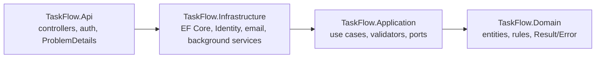
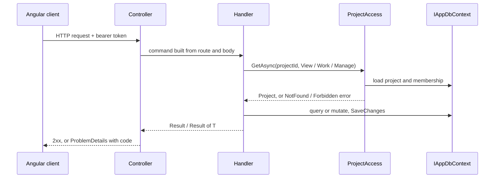
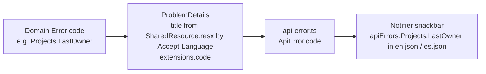
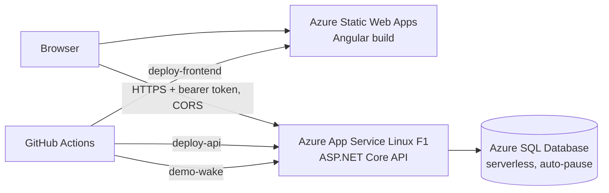

# Architecture

This page describes how TaskFlow is put together. For the reasons behind individual choices, see the
[ADR index](adr/README.md).

## Backend layers

Four projects in `backend/src` (ADR 0001). Dependencies point inward, and `ArchitectureTests` in the unit-test
projects fail the build if a reference goes the other way.



- **Domain** holds `Client`, `Project` (the aggregate root that owns its members), `TaskItem` and the
  notification entities, with private setters. Rules are entity methods that return `Result`/`Error` instead of
  throwing; each entity file also holds its `XxxErrors`.
- **Application** holds the use cases: one file per use case, a command plus a `...Handler` class. Handlers are
  registered by naming convention, as are the FluentValidation validators. There is no mediator library and no
  repository layer: handlers query `IAppDbContext` directly (ADR 0006). Ports such as `IAppDbContext`,
  `IIdentityService` and `ICurrentUser` are declared here.
- **Infrastructure** implements the ports: `AppDbContext` (EF Core on SQL Server), ASP.NET Identity, SMTP email,
  migrations, and the hosted background services.
- **Api** holds the controllers (derived from `ApiControllerBase`), the Identity endpoints, middleware,
  localization and the mapping of errors to HTTP.

## Request flow



1. A controller turns the request into a command (route ids come from small request records declared next to the
   controller) and calls its handler. FluentValidation failures become a `ValidationProblemDetails`.
2. Every project-scoped handler starts with `ProjectAccess.GetAsync(projectId, ProjectAccessLevel.View|Work|Manage)`,
   which answers 404 for a project the caller can't see and 403 for insufficient rights (ADR 0006).
3. The handler applies the domain rule (an entity method returning `Result`), saves through `IAppDbContext`, and
   returns `Result`/`Result<T>`. Projects and tasks carry a `rowversion`; an edit with an old one returns
   `CommonErrors.Stale` (409). Time comes from `TimeProvider`.
4. The controller maps the result with `OkOrProblem` / `CreatedOrProblem` / `NoContentOrProblem`. An `ErrorType`
   becomes 404, 409, 403 or 400. The `ProblemDetails` title is localized by looking up the error **code** in
   `Resources/SharedResource{.es}.resx` using the request's `Accept-Language` (`en` default, `es`), and the code is
   also sent as `extensions.code`.

Activity-log entries and notifications are written by the handlers in the same transaction as the change that
causes them (ADRs 0009 and 0010).

## Authentication

- ASP.NET Core Identity API Endpoints (`MapIdentityApi`) under `/api/auth` issue **bearer tokens plus a refresh
  token**, not cookies, because the frontend and API live on different sites (ADRs 0002, 0003). Everything else is
  controllers.
- `/api/auth` and `/api/invitations` are rate limited per IP. Behind a proxy the client IP comes from
  `X-Forwarded-For` for the networks in `ForwardedHeaders:KnownNetworks`.
- `SessionValidationMiddleware` rejects a bearer token whose security stamp is no longer the user's
  (`SessionValidator`, cached 30 s). Deactivating a user or changing their role renews the stamp, so it takes
  effect at once; code that renews a stamp calls `SessionValidator.Forget`.
- Admins invite users: the account has no password until the user follows the emailed link (ADR 0008). Every
  emailed link points to a frontend page and carries its values in the URL fragment.

## Background services

Both are `BackgroundService`s in Infrastructure and are written to survive restarts and several instances.

- **Due-soon notifications** (`DueSoonNotificationService`): once a day at `DueSoonHourUtc` (default 08:00 UTC) it
  runs `NotifyDueSoonHandler`. If the app starts after that hour it runs at once; the handler is idempotent.
- **Demo reset** (`DemoResetService`): when `Demo:Enabled` is on, it checks at startup and every
  `CheckIntervalMinutes` whether the last reset (`DemoResetLog`) is older than the most recent occurrence of
  `Demo:ResetCron` (computed with Cronos). A reset missed while the free-tier app slept therefore runs on the next
  start. A SQL application lock prevents concurrent resets, and a GitHub Actions workflow (`demo-wake.yml`) pings
  the API shortly after the reset time to wake it (ADR 0005).

## Frontend structure

```
frontend/src/app/
  core/                 auth, http (ApiError), i18n, notifications (snackbar), demo, title (route titles + announcements)
  shared/               data-access helpers (submissions), ui (confirm dialog, empty state, PagedList, ...)
  features/<feature>/
    data-access/        API service + store/ (actions, effects, feature)
    ui/                 presentational components
    pages/              routed components
    <feature>.routes.ts loaded with loadChildren; provides state and effects on the route
```

- **State.** Each feature registers its NgRx state and effects on its route (`provideState` / `provideEffects`);
  auth is registered at the root. Features are `createFeature` slices, lists use `@ngrx/entity`, effects are
  functional, and reducers reset on logout or session expiry.
- **Writes.** Write effects use `concatMap` so none is dropped. Form dialogs stay open until the API answers: the
  page passes a `SaveFn` that tags the action with a `submissionId`, effects copy it onto the success or failure
  action, and `Submissions.dispatchAndWait` returns that outcome. `applyApiFieldErrors` shows validation
  messages under the fields.
- **Board.** Moving a card updates the store optimistically (`board.ts` mirrors the API's renumbering) and keeps an
  undo; tasks reload after each move because the API renumbers and re-versions the neighbors.
- **Token refresh.** `authInterceptor` attaches the bearer token only to URLs under `${apiUrl}/api/`. The access
  token is kept in memory and the refresh token in `localStorage`; `token-refresher` refreshes once on a 401 and
  shares the result between concurrent requests. `restoreSession`, an app initializer, restores the session before
  the first navigation.

## Error codes and i18n



The API localizes the title for any client, and sends the stable code so the frontend can translate it itself with
Transloco. A new error code therefore needs entries in both `.resx` files and both JSON files
(`public/i18n/en.json`, `es.json`). An interceptor sends `Accept-Language` with every request.

## Deployment topology



The frontend and API are on different origins, so the API's CORS settings allow the static web app's origin and
tokens travel in headers. In Development and on Azure (Bicep app settings) the API migrates and seeds the database on startup (`Database:MigrateOnStartup` / `SeedOnStartup`). Resources are defined in
`infra/main.bicep`; see [infra/README.md](../infra/README.md) and ADR 0011.
